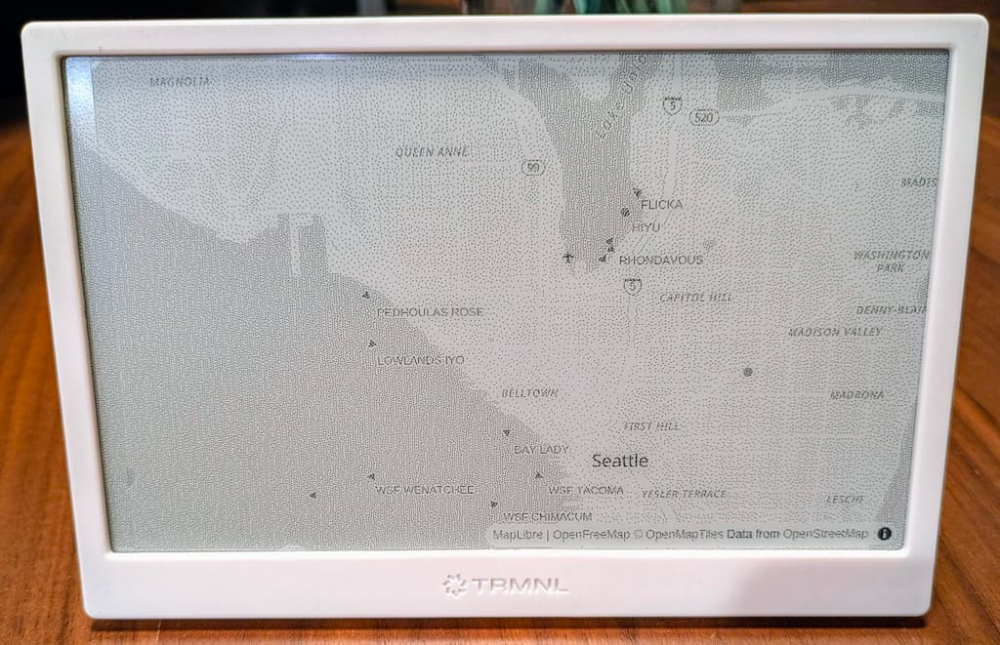

# localmap

`localmap` generates images of your local area with overlays of recent 
boat and plane traffic in response to HTTP requests. It was designed to
produce [TRMNL](https://trmnl.com/) compatible images for use with the
[alias plugin](https://help.trmnl.com/en/articles/10701448-alias-plugin).



Note: This project is not affiliated with TRMNL.

## Running

Quick run (requires Go toolchain):

```bash
go build ./cmd/localmap
LM_MAP_LAT_DD=0.0 LM_MAP_LON_DD=0.0 LM_MAP_ZOOM=12 LM_RENDERER=browser ./localmap
```

Or build the Docker image:

```bash
docker build -t localmap:dev .
docker run -p 8080:8080 -e LM_MAP_LAT_DD=0.0 -e LM_MAP_LON_DD=0.0 -e LM_MAP_ZOOM=12 -e LM_RENDERER=browser localmap:dev
```

The server's URL will be printed in the logs on startup. You can visit it and play with
live maps to see if you got your configuration right.

Then, use the [alias plugin](https://help.trmnl.com/en/articles/10701448-alias-plugin)
to fetch images on your local network from your TRMNL. The URL will be:

```
<your host>:<port>/cachedmap/png?profile=trmnl_v1_alias
```

## Configuration

Environment variables:

* `LM_CACHE_DIR` - Directory to cache pre-computed images, defaults to `/tmp`
* `LM_MAP_LAT_DD` - Latitude in decimal degrees to center the map around.
* `LM_MAP_LON_DD` - Longitude in decimal degrees to center the map around.
* `LM_MAP_ZOOM` - Zoom level of the base map.
* `LM_ADDR` - Address to listen on, defaults to `:8080`.
* `LM_AISCATCHER_URL` - URL to an [AISCatcher instance](https://github.com/jvde-github/AIS-catcher/)

Image URL parameters:

* `width_px` - integer width to render the image at, default `800` px.
* `height_px` - integer height to render the image at, default `480` px.
* `profile` - profile that overrides other params. The only valid values are `trmnl_v1_alias` or unset.
* `monochrome` - "true" or "false", whether the output should be monochrome.
* `colors` - integer number of colors to render the image at.
* `depth` - integer color depth to render the image at.
* `dither` - "true" or "false", whether the output should be dithered.

The profile `trmnl_v1_alias` is effectively:

```
?width_px=800&height_px=480&colors=2&dither=true&depth=1&monochrome=true
```

## Image Generation Pipeline

In order to keep battery usage low on the fetching device, localmap pre-generates cached
images every 5 minutes.

1. Check if a different image was created in the last 5 minutes, if so serve that.
2. Fetch updated data for each enabled plugin and cache it.
3. Compose the data over the base layer supplied by openfreemap.org.
4. Convert the map data into an image.
5. Cache the image.
6. Delete any old images.
7. Return the image.
